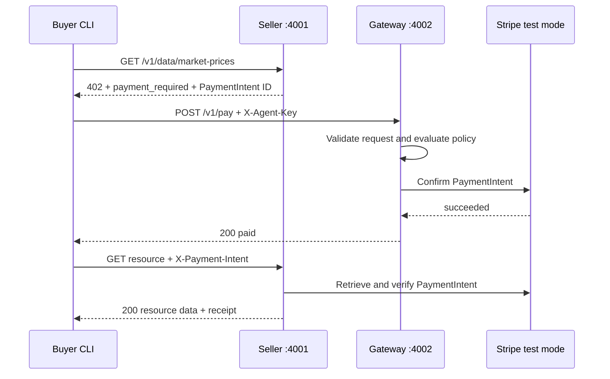
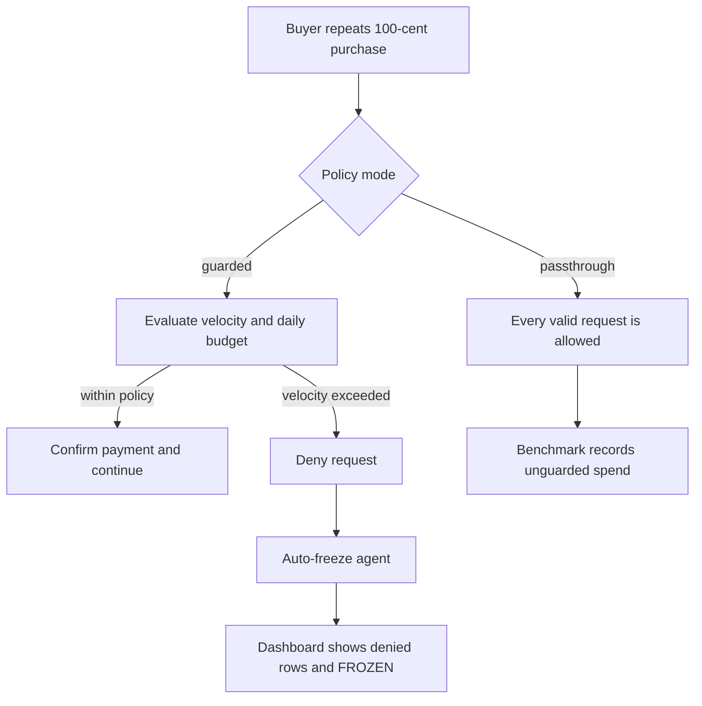
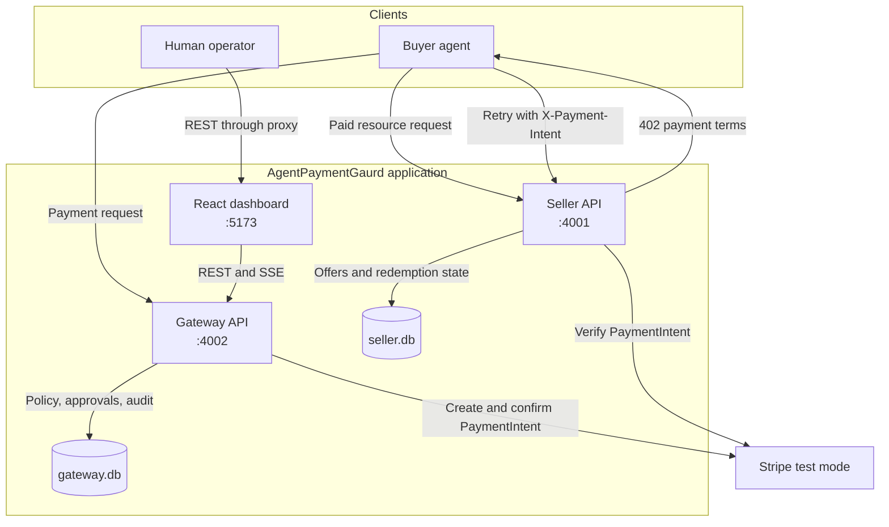
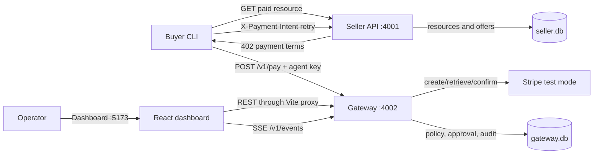
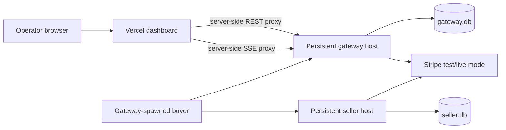

# AgentPaymentGaurd

AgentPaymentGaurd is a TypeScript monorepo demonstrating a guarded machine-to-machine payment flow. A buyer agent requests a paid resource from a seller, receives an HTTP `402 Payment Required` response, asks a payment gateway to authorize the purchase, and retries the seller with the resulting Stripe PaymentIntent. The gateway is the only component that can spend and applies budget, allowlist, approval, velocity, and freeze policies before it contacts Stripe.

The project is a local/demo system using Stripe test mode, SQLite, and a single seeded buyer and seller. It is not a production multi-tenant wallet or a live-money payment product.

## Contents

- [Project overview](#project-overview)
- [Features](#features)
- [Pages and navigation](#pages-and-navigation)
- [User journeys](#user-journeys)
- [Technology stack](#technology-stack)
- [Architecture and data flow](#architecture-and-data-flow)
- [Repository structure](#repository-structure)
- [Installation and setup](#installation-and-setup)
- [Environment variables](#environment-variables)
- [API reference](#api-reference)
- [Database](#database)
- [Authentication and security](#authentication-and-security)
- [UI/UX](#uiux)
- [Application states and errors](#application-states-and-errors)
- [Deployment](#deployment)
- [Testing and benchmarks](#testing-and-benchmarks)
- [Limitations and future improvements](#limitations-and-future-improvements)
- [Troubleshooting](#troubleshooting)
- [Contributing](#contributing)
- [License and acknowledgements](#license-and-acknowledgements)

## Project overview

### Purpose

The project explores a safety layer for autonomous agents that are allowed to buy APIs or datasets. It solves the problem of an agent spending repeatedly or purchasing from an untrusted seller without a human-visible control point.

### Actors

| Actor | Responsibility |
| --- | --- |
| Buyer agent | Calls the seller, submits payment requests, polls pending payments, and retries the seller after payment. |
| Seller service | Hosts paid resources, creates payment offers, verifies Stripe payments, and delivers a resource once. |
| Gateway | Authenticates the buyer, evaluates policy, confirms Stripe payments, records transactions, and exposes operator APIs. |
| Human operator | Uses the dashboard to approve or reject purchases, freeze agents, inspect activity, and run demos. |
| Stripe test mode | Provides PaymentIntent creation, retrieval, and confirmation without live money. |

### What makes the demo useful

- The buyer never receives the Stripe secret key.
- Policy evaluation is a deterministic pure function with explainable reason codes.
- Pending spend reserves budget before an external payment call.
- A velocity breach can automatically freeze the buyer agent.
- Seller redemption is one-time and checks the payment with Stripe rather than trusting the buyer header.
- The dashboard receives gateway events over Server-Sent Events (SSE).
- The benchmark compares a guarded run with a `passthrough` baseline.

All monetary amounts are integer minor units. The seeded demo uses cents and `usd`.

## Features

### HTTP 402 payment flow

`GET /v1/data/:resourceId` initially returns `402` and a `payment_required` object containing the seller, resource, amount, currency, PaymentIntent ID, and expiry. It also sends `WWW-Authenticate: Payment intent="..."`.

The buyer submits those terms to `POST /v1/pay`. If the gateway allows the purchase, it confirms the PaymentIntent using the configured Stripe test PaymentMethod. The buyer then retries the seller with `X-Payment-Intent`. The seller retrieves the intent from Stripe, verifies status, amount, currency, the locally stored offer/resource binding, expiry, and one-time redemption, and returns the payload.

### Policy engine

In guarded mode, `evaluatePolicy()` applies rules in this order:

1. Duplicate PaymentIntent.
2. Frozen agent.
3. Currency allowlist.
4. Seller allowlist.
5. Velocity window.
6. Per-purchase cap.
7. Daily cap, including pending and processing amounts.
8. Approval threshold.
9. Allow.

The default seeded policy is:

| Rule | Default |
| --- | ---: |
| Per-purchase cap | 500 cents |
| Daily cap | 500 cents |
| Approval threshold | Purchases over 300 cents |
| Velocity | 5 purchases per 10 seconds |
| Allowed seller | `seller_demo` |
| Allowed currency | `usd` |
| Auto-freeze on velocity | Enabled |

The policy returns `allow`, `deny`, or `needs_approval` plus a reason code and human-readable message.

### Human approval

A purchase over the approval threshold is stored as `pending_approval` and appears in the dashboard. The operator can add an optional note and approve or reject it. Approval rechecks the agent frozen state, seller allowlist, per-purchase cap, and daily budget before confirming the PaymentIntent. Pending approvals expire after 120 seconds and are treated as rejected.

### Budget and kill switch

The gateway counts succeeded, processing, and pending-approval amounts for daily budget protection. Operators can freeze or unfreeze an agent. A velocity breach can freeze it automatically; subsequent payments are denied with `AGENT_FROZEN`.

### Audit trail

Gateway decisions, payment outcomes, policy changes, mode changes, freezes, unfreezes, resets, approvals, and failures are written to the SQLite `audit_log`. The dashboard displays the newest entries and can filter by event, agent, or search text such as a PaymentIntent ID. Audit rows are read-only in the dashboard.

### Realtime dashboard updates

The gateway publishes transaction, approval, agent, mode, and demo events over an authenticated SSE stream. The dashboard reconnects when the stream drops and refreshes its REST snapshot after reconnecting or receiving an event.

The dashboard reducer stores mode and demo-status events directly. For transaction, approval, freeze, and unfreeze events it schedules a debounced snapshot refresh rather than mutating the event payload directly. This keeps the UI aligned with the authoritative SQLite reads. If a transaction remains `processing`, the dashboard refreshes every two seconds until the status changes.

### Demo scenarios

The dashboard can start these development-only gateway scenarios:

| Dashboard label | Gateway scenario | Behavior |
| --- | --- | --- |
| Happy path | `happy_path` | One `market-prices` purchase. |
| Large purchase (approval) | `large_purchase` | One 400-cent `premium-dataset` purchase requiring approval. |
| Runaway agent | `runaway` | Repeated 100-cent `market-prices` purchases under guarded mode. |
| Runaway, unguarded baseline | `runaway_unguarded` | The runaway buyer in `passthrough` mode, restored to guarded mode afterward. |

The gateway also supports stopping an active demo and resetting local demo state.

## Pages and navigation

There is one React/Vite dashboard page. It is not a multi-page application and does not use a routing library. Hash links select sections of the same screen:

| Hash | Section | Purpose |
| --- | --- | --- |
| `#overview` | Overview | Budget, mode, KPIs, history chart, and latest gate evaluation. |
| `#approvals` | Approvals | Pending human approval cards. |
| `#transactions` | Transactions | Live transaction table. |
| `#audit` | Audit | Filterable, expandable audit log. |

Opening the root dashboard without a hash defaults to `#overview`.

### Overview and top bar

The top bar displays the `AgentPaymentGaurd` name, the current `guarded` or `passthrough` mode, connection status, a demo selector, `Run demo`/`Stop demo`, and `Reset`.

- **Mode badge:** reflects `GET /api/admin/mode`, which the Vite proxy forwards to the gateway.
- **Demo selector:** chooses one of the four development scenarios. The button starts `POST /v1/admin/demo/:scenario` through the proxy.
- **Stop demo:** calls `POST /v1/admin/demo/stop` while a scenario is active.
- **Reset:** calls `POST /v1/admin/reset`; it is disabled while a demo is running.
- **Reconnecting:** appears when the SSE connection is unavailable.
- **Error retry:** appears for snapshot failures and calls the dashboard refresh again.
- **Passthrough banner:** when the mode is `passthrough`, a full-width alert says `PASSTHROUGH: NO LIMITS (BASELINE RUN)`.

`passthrough` is intentionally available for benchmark baselines. It bypasses policy evaluation and should not be used as a production safety mode.

### Budget panel

The budget panel uses the first agent returned by `/v1/admin/agents` (currently the seeded `agent_buyer_1`). It displays:

- Spent today, pending/processing amount, cap, and remaining budget.
- A semicircular gauge whose tone changes at 70% and 90% of the cap.
- Frozen state and freeze reason.
- **Freeze agent** or **Unfreeze agent**, calling the corresponding admin endpoint.

If the gateway has no configured agent, the panel shows an explicit unavailable/empty message.

### KPI cards and history chart

The KPI cards show spent cents, count and amount of blocked transactions, and pending approval count. Sparklines are calculated from the loaded transaction/approval snapshot.

The transaction history chart groups the loaded transactions into succeeded, blocked, and pending buckets. Period controls filter the data to 24 hours, 7 days, 30 days, or 90 days. The chart is a client-side view of the latest 500 transactions returned by the gateway; it is not a separate analytics API.

The **Gate evaluation** panel explains the most recent transaction against the eight displayed policy gates: duplicate intent, agent status, currency allowlist, seller allowlist, velocity limit, purchase cap, daily budget, and human approval. Each gate is labeled `Passed`, `Denied`, `Review`, or `Skipped`. This is a visual explanation of the transaction's stored decision/reason code; it does not re-run the backend policy in the browser. When no transaction exists, it prompts the operator to run a demo.

### Pending approvals

Each approval card shows resource, amount, agent, seller, purpose, waiting time, and seconds remaining in the 120-second window. The optional note input is limited to 1,000 characters.

- **Approve:** calls `/v1/admin/approvals/:id/approve`.
- **Reject:** calls `/v1/admin/approvals/:id/reject`.
- A new approval is briefly highlighted and flashes the browser title.
- An empty queue says `No purchases waiting for you.`

### Live transaction feed

The table displays time, agent, resource, amount, status, and reason. It filters the loaded snapshot by the selected history period and refreshes following SSE events. Status text is retained in chips, including `succeeded`, `pending approval`, `denied`, `rejected`, and `failed`.

The empty state instructs the operator to run a demo.

### Audit log

The audit table shows timestamp, event, agent, reason, amount, reference ID, and detail. The gateway supplies up to 100 newest records. The dashboard supports event and agent filters plus text search over reference IDs, PaymentIntent IDs, and serialized detail. Rows can be expanded with keyboard or pointer interaction to inspect detail JSON.

The event filter is populated from event values present in the loaded snapshot, and the agent filter is populated from loaded agents. The search field is labeled `Search ref / PI id`; it is a client-side filter after the initial snapshot has loaded. An unmatched filter displays `No audit entries match these filters.` The table includes an explicit `Append-only record · Read only` note.

## User journeys

### First-time operator

1. Create the root `.env` and provide Stripe test credentials and non-placeholder keys.
2. Start the seller, gateway, and dashboard.
3. Open `http://localhost:5173`.
4. The dashboard loads agents, approvals, transactions, audit entries, and mode in parallel.
5. It opens one SSE connection for live events.

### Buyer happy path



### Approval journey

1. The buyer requests `premium-dataset` for 400 cents.
2. The gateway returns `202` with `pending_approval` and an approval ID.
3. The gateway emits an approval event; the dashboard refreshes and shows a card.
4. The operator approves or rejects.
5. On approval, the gateway confirms Stripe and changes the transaction to succeeded, unless a recheck or provider failure prevents it.
6. The buyer polls `GET /v1/pay/:paymentIntentId` and then retries the seller only after `paid`.

### Runaway journey



### Logout and account management

There is no user registration, login page, logout action, account profile, or multi-user account management. Authentication is service-key based and intended for the local demo.

## Technology stack

| Area | Technology | Use |
| --- | --- | --- |
| Runtime | Node.js with native ESM | Runs the services, buyer CLI, and benchmark. |
| Language | TypeScript 5.7, strict mode | Shared types and application code. |
| Frontend | React 18, React DOM 18 | Single dashboard screen. |
| Frontend tooling | Vite 6 | Dashboard dev server, build, and gateway proxy. |
| Backend | Express 4 | Seller and gateway HTTP APIs. |
| Database | SQLite via `better-sqlite3` | Local gateway state, seller resources/offers, WAL mode. |
| Payments | Stripe Node SDK 17 | Test-mode PaymentIntent create/retrieve/confirm. |
| Validation | Zod 3 | Buyer payment request validation and admin input validation. |
| State management | React `useReducer` and hooks | Dashboard snapshot/event state. |
| Realtime | Server-Sent Events | Gateway-to-dashboard events. |
| Tests | Vitest 2 | Unit and service integration tests. |
| Build | TypeScript project references | Root build across shared and backend workspaces. |

No deployment provider, ORM, CSS framework, UI component library, authentication provider, or frontend routing package is configured.

## Architecture and data flow

### High-level architecture



The gateway is the spending boundary: the buyer can request payment, but only the gateway can confirm a Stripe PaymentIntent. The seller independently verifies payment before delivering a resource, while the dashboard gives the operator approval and monitoring controls.

### Runtime data flow



The gateway wraps policy-state reads and transaction reservation in a SQLite transaction. Payment-provider calls occur outside that database transaction. A successful provider response changes `processing` to `succeeded`; an ordinary provider error changes it to `failed`. An ambiguous provider outcome remains `processing` and is reconciled when the buyer polls the payment status endpoint.

The dashboard proxy maps:

- `/api/admin/*` to gateway `/v1/admin/*`
- `/api/events` to gateway `/v1/events`

The proxy reads `ADMIN_KEY` from the root environment on the server side and adds `X-Admin-Key`; browser bundles do not receive the raw admin key through a `VITE_*` variable.

## Repository structure

The following is the application structure; generated `node_modules`, `dist`, SQLite sidecar files, and TypeScript build-info files are intentionally omitted.

```text
AgentPayGaurd/
├── package.json
├── tsconfig.json
├── tsconfig.base.json
├── vitest.config.ts
├── .gitignore
├── .env                         # local, ignored; not committed
├── API_SPEC.md                  # endpoint and shared-type specification
├── ARCHITECTURE.md              # architecture and trust-boundary notes
├── DATABASE_SCHEMA.md           # schema reference
├── DEMO_METRICS.md              # benchmark and demo script
├── DESIGN2.md                   # dashboard design tokens
├── POLICY_ENGINE.md             # policy rules and lifecycle
├── PROJECT_SPEC.md              # project goals and rubric
├── TASKS.md                     # build-plan notes
├── docs/
│   └── METRIC_LOCKED.md
├── packages/
│   └── shared/
│       ├── package.json
│       ├── tsconfig.json
│       └── src/
│           ├── index.ts
│           └── index.test.ts
├── services/
│   ├── gateway/
│   │   ├── package.json
│   │   ├── tsconfig.json
│   │   └── src/
│   │       ├── index.ts
│   │       ├── database.ts
│   │       ├── pay.ts
│   │       ├── policy.ts
│   │       ├── admin.ts
│   │       ├── events.ts
│   │       ├── payment-reconciliation.ts
│   │       ├── pay.test.ts
│   │       └── policy.test.ts
│   └── seller/
│       ├── package.json
│       ├── tsconfig.json
│       └── src/
│           ├── index.ts
│           ├── database.ts
│           ├── seller.ts
│           └── index.test.ts
├── agents/
│   └── buyer/
│       ├── package.json
│       ├── tsconfig.json
│       └── src/
│           ├── index.ts
│           ├── bench.ts
│           ├── index.test.ts
│           └── bench.test.ts
└── apps/
    └── dashboard/
        ├── package.json
        ├── tsconfig.json
        ├── vite.config.ts
        ├── vercel.json
        ├── api/
        │   ├── _proxy.ts
        │   ├── admin/[...path].ts
        │   └── events.ts
        ├── index.html
        ├── public/favicon.ico
        └── src/
            ├── main.tsx
            ├── App.tsx
            ├── api.ts
            ├── store.ts
            └── styles.css
```

Important implementation files:

- `packages/shared/src/index.ts`: `PayRequest` Zod schema, policy types, decision and reason-code unions.
- `services/seller/src/seller.ts`: paid-resource endpoint and Stripe-backed offer redemption.
- `services/seller/src/database.ts`: resource and offer schema plus demo seed data.
- `services/gateway/src/policy.ts`: pure policy evaluation.
- `services/gateway/src/pay.ts`: buyer authentication, payment flow, budget queries, and reconciliation polling.
- `services/gateway/src/admin.ts`: operator routes, approval lifecycle, reset, demos, mode switching, and SSE registration.
- `services/gateway/src/database.ts`: gateway schema, WAL/foreign-key setup, and seeded agent/policy.
- `agents/buyer/src/index.ts`: buyer HTTP workflow and `happy`, `approval`, and `runaway` scenarios.
- `agents/buyer/src/bench.ts`: confirmed 60-run benchmark, checkpointing, resume, and result generation.
- `apps/dashboard/src/App.tsx`: all dashboard UI and interactions in one component file.
- `apps/dashboard/src/api.ts`: typed REST helpers and EventSource integration.
- `apps/dashboard/src/store.ts`: dashboard reducer and event state types.
- `apps/dashboard/vite.config.ts`: server-side environment filtering and gateway proxy.

## Installation and setup

### Prerequisites

- Node.js with npm workspaces support. The exact Node version is not pinned in the repository; use a current LTS release compatible with the installed TypeScript, Vite, and `better-sqlite3` packages.
- A Stripe account and a Stripe **test-mode** secret key beginning with `sk_test_`.
- Internet access for Stripe test-mode API calls.

### Install

From the repository root:

```powershell
npm install
```

### Configure the root environment

The repository currently contains a local `.env`, but no tracked `.env.example` file. Create or edit the ignored root `.env` with values like the following, replacing both placeholder secrets:

```dotenv
STRIPE_SECRET_KEY=sk_test_replace_me
STRIPE_TEST_PAYMENT_METHOD=pm_card_visa
NODE_ENV=development
CURRENCY=usd
POLICY_MODE=guarded
SELLER_PORT=4001
GATEWAY_PORT=4002
SELLER_URL=http://localhost:4001
GATEWAY_URL=http://localhost:4002
ADMIN_KEY=replace_with_a_long_random_admin_key
BUYER_AGENT_KEY=replace_with_a_long_random_agent_key
BUYER_AGENT_ID=agent_buyer_1
```

`STRIPE_SECRET_KEY`, `STRIPE_TEST_PAYMENT_METHOD`, `ADMIN_KEY`, and `BUYER_AGENT_KEY` are required for the gateway. The seller requires the Stripe secret key. URLs and ports have the defaults shown above. The buyer ID defaults to `agent_buyer_1` if omitted.

The gateway and seller load `.env` from the monorepo root based on the source-file location, not the current working directory. Do not commit `.env`, Stripe keys, or database files.

### Start the services

Use separate terminals from the root:

```powershell
npm run dev:seller
npm run dev:gateway
npm run dev:dashboard
```

Then open `http://localhost:5173`. The seller listens on `http://localhost:4001`; the gateway listens on `http://localhost:4002`.

The gateway and seller initialize their SQLite schemas and seed data on startup. Existing local databases are reused. The gateway seeds `agent_buyer_1` and its default policy; the seller seeds `market-prices` and `premium-dataset`.

### Run buyer scenarios

With seller and gateway running:

```powershell
npm run buyer -- happy
npm run buyer -- approval
npm run buyer -- runaway
```

The buyer prints a summary containing purchases, cents spent, stop reason, and elapsed milliseconds.

## Environment variables

| Variable | Required | Used by | Purpose |
| --- | --- | --- | --- |
| `STRIPE_SECRET_KEY` | Yes for seller/gateway | Seller, gateway, benchmark | Stripe test secret; must start with `sk_test_`. Obtain it from Stripe test-mode API keys. |
| `STRIPE_TEST_PAYMENT_METHOD` | Yes for gateway | Gateway | PaymentMethod used to confirm test intents, for example `pm_card_visa`. |
| `NODE_ENV` | Optional | Gateway, benchmark | Production disables reset and demo routes; benchmark refuses production. Defaults to development behavior. |
| `CURRENCY` | Optional | Seller, gateway | Three-letter currency code. Defaults to `usd`. |
| `POLICY_MODE` | Optional | Gateway | Initial `guarded` or `passthrough` mode. Defaults to `guarded`; persisted settings control later requests. |
| `SELLER_PORT` | Optional | Seller | TCP port, default `4001`. |
| `GATEWAY_PORT` | Optional | Gateway | TCP port, default `4002`. |
| `SELLER_URL` | Optional | Buyer/benchmark | Seller base URL, default `http://localhost:4001`. |
| `GATEWAY_URL` | Optional | Buyer/benchmark/Vite | Gateway base URL, default `http://localhost:4002`. |
| `ADMIN_KEY` | Yes for gateway/dashboard/benchmark | Gateway and Vite config | Shared admin secret for operator routes. The Vite dev proxy uses it server-side. |
| `BUYER_AGENT_KEY` | Yes for gateway/buyer/benchmark | Gateway and buyer | Shared buyer secret, stored in the gateway as a SHA-256 hash. |
| `BUYER_AGENT_ID` | Optional | Buyer/benchmark | Buyer agent ID, default `agent_buyer_1`. |

There is no implemented use of an `LLM_BRAIN` variable in the buyer runtime. Do not configure it as an application feature unless the implementation is extended.

## API reference

All JSON errors use:

```json
{
  "error": {
    "code": "ERROR_CODE",
    "message": "Human-readable explanation"
  }
}
```

Amounts are integer minor units. Buyer routes require `X-Agent-Key`; admin routes require `X-Admin-Key`.

### Seller API (`:4001`)

#### `GET /health`

Returns `{ "ok": true }`.

#### `GET /v1/data/:resourceId`

Returns a paid resource or creates a payment offer.

- Without `X-Payment-Intent`: `402` with `payment_required` and a `WWW-Authenticate` header.
- With a valid, succeeded, matching, unredeemed PaymentIntent: `200` with:

  ```json
  {
    "resource_id": "market-prices",
    "data": {},
    "receipt_id": "rcpt_..."
  }
  ```

- Unknown, mismatched, expired, or unpaid intents do not deliver data.
- A redeemed intent returns `409 ALREADY_REDEEMED`.
- Stripe lookup or offer creation failure returns `502 PAYMENT_PROVIDER_ERROR`.
- Unknown resources return `404 RESOURCE_NOT_FOUND`.

The seller creates intents with `confirm: false`, automatic payment methods with redirects disabled, and metadata containing `seller_id` and `resource_id`. It stores the intent in a local `offers` row, then uses that row to bind the intent to the requested resource. Redemption checks the Stripe intent ID, amount, currency, and `succeeded` status; the current seller implementation does not separately compare the returned Stripe metadata fields during redemption. Offers expire after 15 minutes.

The initial `402` body has this shape:

```json
{
  "payment_required": {
    "seller_id": "seller_demo",
    "resource_id": "market-prices",
    "amount": 100,
    "currency": "usd",
    "payment_intent_id": "pi_...",
    "expires_at": "2026-11-04T00:00:00.000Z"
  }
}
```

### Gateway buyer API (`:4002`)

#### `GET /health`

Returns `{ "ok": true, "mode": "guarded" }`.

#### `POST /v1/pay`

Requires `X-Agent-Key`. Body:

```json
{
  "agent_id": "agent_buyer_1",
  "payment_intent_id": "pi_...",
  "seller_id": "seller_demo",
  "resource_id": "market-prices",
  "amount": 100,
  "currency": "usd",
  "purpose": "Need current prices"
}
```

The body is validated by Zod. Responses include:

| Status | Meaning |
| ---: | --- |
| `200` | Payment was allowed and confirmed: `{ status: "paid", transaction_id, payment_intent_id, decision, reason }`. |
| `202` | `pending_approval` with `approval_id`, or `processing` when confirmation is ambiguous. |
| `401` | Invalid/missing `X-Agent-Key` (`BAD_AGENT_KEY`). |
| `403` | Policy denial, including caps, allowlist, frozen, velocity, or currency reasons. |
| `409` | PaymentIntent already exists in gateway transactions. |
| `422` | Invalid request body. |
| `502` | Stripe provider failure. |

On an allowed request, the gateway first inserts a `processing` transaction and audit row inside a SQLite transaction, then confirms Stripe outside that SQLite transaction. A successful confirmation updates the transaction to `succeeded` and emits a transaction event. A normal provider failure updates it to `failed` and returns `PAYMENT_PROVIDER_ERROR`. If the provider result is ambiguous, the transaction remains `processing`, an audit entry records `PAYMENT_RECONCILIATION_PENDING`, and the buyer must poll.

#### `GET /v1/pay/:paymentIntentId`

Requires the matching buyer key. Returns transaction status such as `processing`, `paid`, `pending_approval`, `rejected`, `denied`, or `failed`. If a prior provider response was ambiguous, this endpoint attempts PaymentIntent reconciliation.

#### `GET /v1/agents/:agentId/budget`

Requires either the agent key for that agent or the admin key. Returns daily cap, spent amount, pending amount, remaining amount, frozen state, and freeze reason.

### Gateway admin API (`/v1/admin`)

Every endpoint below requires `X-Admin-Key`.

| Method | Path | Purpose |
| --- | --- | --- |
| `GET` | `/agents` | List agents, policy configuration, budget totals, and frozen state. |
| `PUT` | `/agents/:id/policy` | Validate and update caps, threshold, velocity, seller/currency allowlists, and auto-freeze. |
| `POST` | `/agents/:id/freeze` | Freeze an agent; optional body `{ "reason": "..." }`. |
| `POST` | `/agents/:id/unfreeze` | Unfreeze an agent. |
| `GET` | `/approvals?status=pending` | List approvals by `pending`, `approved`, `rejected`, or `expired` status. |
| `POST` | `/approvals/:id/decision` | Body `{ "decision": "approve" \| "reject", "note"?: "..." }`. |
| `POST` | `/approvals/:id/approve` | Approve with optional note. |
| `POST` | `/approvals/:id/reject` | Reject with optional note. |
| `GET` | `/transactions?agent_id=&decision=&limit=` | Newest transaction history; limit is 1–500. |
| `GET` | `/audit?agent_id=&event=&search=&limit=` | Newest audit rows with optional filters; limit is 1–500. |
| `POST` | `/reset` | Development/demo reset of transactions, approvals, and freezes. Disabled in production or during a demo. |
| `POST` | `/demo/stop` | Stop the active development demo. |
| `POST` | `/demo/:scenario` | Start a supported development buyer scenario. Disabled in production. |
| `GET` | `/mode` | Read `guarded` or `passthrough`. |
| `PUT` | `/mode` | Body `{ "mode": "guarded" \| "passthrough" }`. |

#### Admin request validation and status behavior

- Policy updates require positive integer `per_purchase_cap`, `daily_cap`, `velocity_max`, and `velocity_window_s`; a nonnegative integer `approval_threshold`; at least one seller; at least one three-letter currency; and optional boolean `auto_freeze_on_velocity`. Unknown fields are rejected.
- Approval decisions accept only `approve` or `reject` and an optional note up to 1,000 characters. A decision that races with another resolution returns `409 APPROVAL_ALREADY_RESOLVED`.
- Transaction and audit `limit` values must be integers from 1 to 500. Invalid decision, status, or limit filters return a structured `400` error.
- Unknown agents return `404 AGENT_NOT_FOUND`; unknown approvals and missing transactions return their corresponding not-found errors.
- Reset returns `403 RESET_DISABLED` in production and `409 DEMO_IN_PROGRESS` while a demo is active. Starting a second demo also returns `409`.
- Demo route names accepted by the gateway include the dashboard names plus aliases: `happy_path`/`happy`, `large_purchase`/`approval`, `runaway`, and `runaway_unguarded`/`baseline`.

#### `GET /v1/events`

Requires `X-Admin-Key`. Returns an SSE stream with events:

- `transaction`
- `approval_requested`
- `approval_resolved`
- `agent_frozen`
- `agent_unfrozen`
- `mode_changed`
- `demo_status`

The stream sends a two-second retry directive and periodic keep-alive comments. The browser does not send an admin header directly because the Vite development proxy rewrites `/api/events` and adds `X-Admin-Key` server-side. Direct clients must send the header themselves.

## Database

Both databases use `better-sqlite3`, enable WAL journaling, enforce foreign keys, and store ISO-8601 UTC strings.

### `gateway.db`

| Table | Important fields and role |
| --- | --- |
| `agents` | Agent ID, name, SHA-256 key hash, frozen flag/reason, creation time. |
| `policies` | Per-agent caps, threshold, velocity window, seller/currency JSON allowlists, auto-freeze. |
| `transactions` | PaymentIntent, seller/resource, amount/currency, purpose, status, decision, reason, timestamps. PaymentIntent is unique. |
| `approvals` | Approval status, transaction/agent references, amount, note, requested/resolved times. |
| `audit_log` | Append-style decision and lifecycle events, amounts, references, and JSON detail. |
| `settings` | Persisted `policy_mode`. |

Daily spend sums succeeded transactions for the UTC date. Pending approvals and processing transactions count toward reserved budget. The gateway atomically reads policy state and inserts the transaction reservation, preventing concurrent requests from bypassing the cap.

### `seller.db`

| Table | Important fields and role |
| --- | --- |
| `resources` | Resource ID, title, price, currency, serialized JSON payload. |
| `offers` | PaymentIntent ID, resource, amount/currency, pending/redeemed/expired status, expiry, redemption time. |

Seeded resources:

- `market-prices`: 100 cents; payload contains ACME and GLOB sample prices.
- `premium-dataset`: 400 cents; payload contains sample market signals.

The checked-in database files are local runtime artifacts and are ignored by `.gitignore`; a clean checkout creates them when services start.

## Authentication and security

- Buyer requests authenticate with `X-Agent-Key`, matched against a SHA-256 hash using a timing-safe comparison.
- Admin routes authenticate with `X-Admin-Key`.
- The dashboard uses the Vite development proxy so the admin key is attached server-side rather than bundled in browser JavaScript.
- The buyer process never loads `STRIPE_SECRET_KEY`.
- Gateway and seller startup reject missing or non-test Stripe secret keys.
- Gateway request bodies are limited to 16 KB and payment requests use Zod validation.
- SQLite foreign keys and transaction boundaries protect local state.
- Seller validates PaymentIntent status, amount, currency, metadata-backed offer identity, expiry, and one-time redemption.
- Provider ambiguity is fail-closed for data delivery: the buyer waits for reconciliation rather than treating an uncertain payment as successful.
- Service outages fail closed in the buyer: after three retry attempts it reports `SELLER_UNAVAILABLE` or `GATEWAY_UNAVAILABLE`.

This is demo-grade shared-key authentication, not production identity management. There are no users, sessions, password accounts, roles beyond buyer/admin keys, rate limiting, key rotation, CSRF system, or multi-tenant isolation.

## UI/UX

The dashboard is a light, white/minimal operations interface implemented with plain CSS. The design uses a soft gray canvas, white hairline-bordered panels, blue actions, text-bearing status chips, and status colors for success, warning, denial, and failure.

- Responsive layout stacks columns and allows table scrolling on smaller screens.
- Controls have visible focus states and keyboard-operable custom dropdowns.
- Status is communicated with text as well as color.
- Loading, reconnecting, error, and empty states are rendered explicitly.
- Reduced-motion preferences and accessible labels are handled in the dashboard CSS/markup.
- The layout uses a left icon rail on larger screens and hash navigation rather than route transitions.

The current dashboard is always light; no dark mode is implemented.

## Application states and errors

### Loading and connectivity

The dashboard shows a loading banner for the first snapshot, an error banner with Retry when REST loading fails, and a reconnecting banner while the SSE stream is unavailable. It retains the latest loaded data while disconnected and refreshes after reconnection.

### Empty states

The UI reports no configured agent, no pending approvals, no transactions, and unavailable sections separately. The approval queue and transaction table do not silently fabricate data.

### Payment and policy failures

Gateway and seller errors use structured codes and status-specific responses. Common reasons include `DAILY_CAP_EXCEEDED`, `PER_PURCHASE_CAP_EXCEEDED`, `SELLER_NOT_ALLOWED`, `AGENT_FROZEN`, `VELOCITY_LIMIT_EXCEEDED`, `CURRENCY_NOT_ALLOWED`, `APPROVAL_REJECTED`, and `PAYMENT_PROVIDER_ERROR`.

### Unexpected failures

Express error handlers return `INVALID_REQUEST` for parse failures and `INTERNAL_ERROR` for unexpected service failures while logging the error type server-side. The dashboard converts network failures into actionable messages and provides retry buttons.

## Deployment

### Important platform boundary

This repository is not a single Vercel application. The dashboard can be deployed to Vercel, but the seller and gateway are long-running Express services that use:

- SQLite files and WAL sidecar files.
- A persistent in-memory SSE subscription hub.
- A one-second approval-expiry sweeper.
- Child-process spawning for dashboard demo scenarios.
- Stripe network calls and local service-to-service URLs.

Do not deploy the seller or gateway as ordinary Vercel static assets. Vercel Functions are request-oriented and do not provide the durable local SQLite/SSE/process model this application currently expects. The supported deployment shape is:



### Recommended split deployment

For this exact codebase, deploy the dashboard to Vercel and deploy the gateway and seller as persistent Node services on a VM or container host with durable storage. Railway, Render, Fly.io, or a small VPS can work; choose a host that supports:

1. Two continuously running Node processes.
2. A persistent volume for `gateway.db`, `gateway.db-shm`, `gateway.db-wal`, `seller.db`, and seller WAL files.
3. HTTPS public URLs.
4. Private environment variables.
5. Long-lived HTTP connections for SSE.

The database paths are derived from the monorepo root, so the backend host must preserve the repository root as writable persistent storage. The current implementation does not expose a configurable database directory. If the chosen platform cannot mount durable storage at the application root, add a storage-path configuration before production use or accept that redeploys can lose local state.

### Deploy the dashboard to Vercel

The repository includes Vercel support in `apps/dashboard/vercel.json` and `apps/dashboard/api/`:

- `/api/admin/*` is handled by a Vercel Node function that calls gateway `/v1/admin/*`.
- `/api/events` is handled by a Vercel Node function that streams gateway `/v1/events`.
- Both functions add `X-Admin-Key` server-side.
- The browser calls same-origin `/api/admin` and `/api/events`; no admin key is bundled into the React build.

Create a Vercel project from the repository with these settings:

| Vercel setting | Value |
| --- | --- |
| Root Directory | `apps/dashboard` |
| Framework preset | Vite |
| Install command | `npm install` |
| Build command | `npm run build` |
| Output directory | `dist` |
| Node.js version | Use a current version supported by the Vercel project settings |

Set these **server-only** Vercel environment variables for Preview and Production:

```text
GATEWAY_URL=https://your-gateway.example.com
ADMIN_KEY=<the same admin key configured on the gateway>
```

Do not name the admin key `VITE_ADMIN_KEY` and do not put it in a browser-visible variable. `GATEWAY_URL` is consumed by Vercel Functions, not by the React bundle.

Deploy with the Vercel dashboard or CLI:

```powershell
npm install -g vercel
vercel login
vercel --cwd apps/dashboard
vercel --cwd apps/dashboard --prod
```

The Vercel project must be able to reach the public HTTPS gateway URL. After deployment, verify:

1. The dashboard loads its initial snapshot.
2. `https://your-dashboard.vercel.app/api/admin/mode` returns the gateway mode when called with the browser session.
3. The dashboard shows `Live` rather than `Reconnecting`.
4. A gateway event appears without a page refresh.
5. Approve/reject, freeze/unfreeze, reset, and demo actions work.

Vercel's SSE proxy is bounded by the function duration configured in `apps/dashboard/api/events.ts`. It is suitable for the dashboard's reconnecting live view, not an unlimited event bus. The gateway itself remains the source of truth.

### Deploy the backend services

Build and run each service from the repository root. The services must share the same root `.env` values where applicable and must be able to reach Stripe.

```powershell
npm install
npm run build --workspace=@agentpay/shared
npm run build --workspace=@agentpay/seller
npm run build --workspace=@agentpay/gateway
node services/seller/dist/index.js
node services/gateway/dist/index.js
```

Run the seller and gateway commands as separate managed services. Configure:

```text
NODE_ENV=production
STRIPE_SECRET_KEY=sk_test_...
STRIPE_TEST_PAYMENT_METHOD=pm_...
CURRENCY=usd
POLICY_MODE=guarded
SELLER_PORT=<platform-provided or internal seller port>
GATEWAY_PORT=<platform-provided or internal gateway port>
SELLER_URL=https://your-seller.example.com
GATEWAY_URL=https://your-gateway.example.com
ADMIN_KEY=<long random operator key>
BUYER_AGENT_KEY=<long random buyer key>
BUYER_AGENT_ID=agent_buyer_1
```

The gateway-spawned buyer inherits `BUYER_AGENT_KEY`, `BUYER_AGENT_ID`, `SELLER_URL`, and `GATEWAY_URL` from the gateway process environment. If these are missing, the dashboard's demo buttons cannot run successfully.

Use the gateway's public HTTPS URL for the Vercel `GATEWAY_URL`. If the seller is private, set `SELLER_URL` to its internal backend address and expose only the gateway publicly; if the buyer process and seller run on separate services, allow the buyer host to reach the seller host.

In `NODE_ENV=production`, the gateway intentionally disables `/v1/admin/reset` and `/v1/admin/demo/:scenario`. This is the safer deployment setting, but it means the dashboard's Reset and Run demo controls will return an error. For a non-production hosted demo, use `NODE_ENV=development` and restrict the gateway with network access controls; never use that mode for real money.

### Backend deployment limitations

The current backend deployment is appropriate for a controlled demonstration, not production payments. Before using live Stripe mode, add durable database migrations/backups, configurable database storage, process supervision, structured logs, TLS termination, rate limiting, key rotation, operator identity, and a strategy for multiple gateway instances. Multiple gateway instances would not share the in-memory SSE event hub or safely coordinate SQLite without additional design.

The verified local build command remains:

```powershell
npm run build
```

It builds the TypeScript project references and the dashboard. No managed database, container image, process manager file, or domain configuration is included.

## Testing and benchmarks

### Tests

Vitest is configured for:

```text
packages/**/*.test.ts
services/**/*.test.ts
agents/**/*.test.ts
```

Run the suite with:

```powershell
npm test
```

The repository contains tests for shared request validation, policy rule ordering and boundaries, gateway payment/admin behavior, seller behavior, buyer scenarios, and benchmark planning/aggregation. No browser end-to-end test suite is configured.

### Build validation

```powershell
npm run build
```

### Benchmark

The benchmark defines three scenarios, each run ten times in both modes:

- **A / Runaway:** up to 50 purchases of `market-prices` at 100 cents.
- **B / Mix:** four 100-cent purchases spaced three seconds apart; false blocks are counted.
- **C / Big:** one 400-cent purchase; guarded mode auto-approves it.

Preview the 60-run plan without network or file changes:

```powershell
npm run bench -- --dry-run
```

Run the confirmed local Stripe test-mode benchmark:

```powershell
npm run bench -- --confirm
```

Resume an interrupted run:

```powershell
npm run bench -- --resume
```

The benchmark checkpoints `results.json` and writes `docs/RESULTS.md` only after completion. It resets local gateway demo data and may create substantial Stripe test-mode activity, so explicit confirmation is required. The checked-in `results.json` is currently an incomplete checkpoint, not a finished benchmark report.

## Limitations and future improvements

### Current limitations

- Stripe test mode only; no live money or alternate payment rails.
- One local seller, one seeded buyer, and one local SQLite database per service.
- Shared API keys are demo-grade authentication.
- No registration, login, sessions, users, roles, or multi-tenant isolation.
- No configured production deployment target.
- No tracked `.env.example` file, although the expected variables are documented above.
- No tracked license file.
- No browser end-to-end tests.
- `passthrough` intentionally bypasses safety policy and is only suitable for a baseline measurement.
- The benchmark depends on local services and Stripe connectivity.
- Dashboard state is refreshed from a bounded snapshot (500 transactions and 100 audit records).

### Potential improvements

These are proposals, not implemented features:

- Add a tracked, secret-free `.env.example` and automated configuration validation.
- Replace shared keys with scoped, rotatable credentials and operator identity.
- Add persistent migrations, backups, observability, and a managed database option.
- Add browser accessibility and end-to-end tests.
- Add rate limiting, HTTPS deployment guidance, and hardened proxy configuration.
- Add pagination or server-side time filtering for long-lived audit and transaction history.
- Add a documented production payment-rail abstraction and live-mode safeguards.

## Troubleshooting

### Gateway refuses to start

Check that the root `.env` contains:

```dotenv
STRIPE_SECRET_KEY=sk_test_...
STRIPE_TEST_PAYMENT_METHOD=pm_...
ADMIN_KEY=<non-placeholder>
BUYER_AGENT_KEY=<non-placeholder>
```

The gateway rejects live-mode keys, missing PaymentMethods, and placeholder admin/buyer keys.

### Seller or gateway port is already in use

Change `SELLER_PORT` or `GATEWAY_PORT`, then update `SELLER_URL`/`GATEWAY_URL` for the buyer and dashboard proxy as appropriate.

### Dashboard cannot connect

Confirm the gateway is running and that `ADMIN_KEY` is available to the Vite process. The Vite server fails fast if no admin key is available in serve mode. Check `/health` on port 4002 and use the dashboard Retry control.

### Buyer reports unavailable services

The buyer retries failed or 5xx requests three times with exponential backoff. Confirm both health endpoints:

```powershell
Invoke-WebRequest http://localhost:4001/health
Invoke-WebRequest http://localhost:4002/health
```

### A purchase stays processing

Stripe confirmation can be ambiguous. Poll `GET /v1/pay/:paymentIntentId` with the buyer key. The gateway attempts reconciliation and will only change the state after a matching Stripe result is known.

### An approval is missing

Confirm the gateway is in guarded mode, the purchase amount is above the 300-cent threshold, and the dashboard SSE connection is live. Refresh the dashboard; pending approvals are loaded from `/v1/admin/approvals?status=pending`.

### Benchmark will not start

The benchmark requires local `SELLER_URL` and `GATEWAY_URL`, non-production `NODE_ENV`, valid test Stripe credentials, and either `--confirm` or `--dry-run`. If `results.json` already exists, use `--resume` for an incomplete checkpoint or archive it before a new confirmed run.

## Contributing

No formal contribution policy is committed. For a local change:

1. Fork the repository and create a focused branch.
2. Read the relevant specification and implementation files before editing.
3. Keep changes scoped and preserve strict TypeScript types.
4. Add or update Vitest coverage for behavior changes.
5. Run `npm test` and `npm run build`.
6. Update this README and the directly related specification when public behavior changes.
7. Open a pull request describing the behavior, validation, configuration changes, and any migration or security implications.

Follow the existing conventions: ESM imports use `.js` specifiers, services load the root environment explicitly, monetary values remain integer minor units, and errors use structured `{ error: { code, message } }` responses.

## License and acknowledgements

No `LICENSE` file or license declaration was found in the repository. Treat the project as unlicensed unless the owner adds an explicit license.

The implementation uses open-source packages including React, Vite, Express, Stripe's Node SDK, `better-sqlite3`, Zod, TypeScript, and Vitest. Their respective licenses remain governed by their package metadata and distribution terms.
